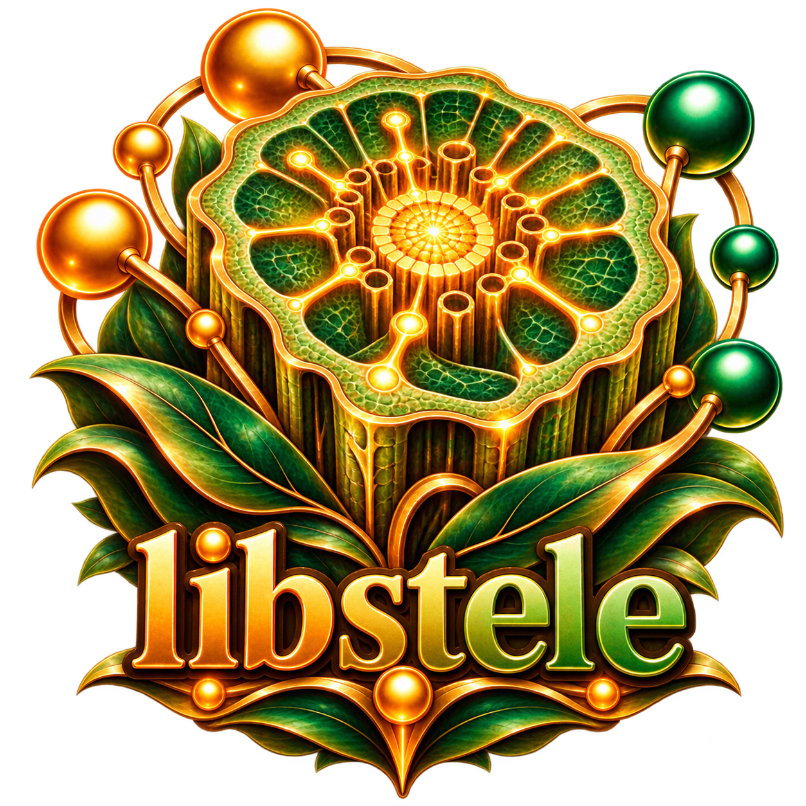

<div align="center">
  
</div>

# @tty-pt/stele

[](https://www.npmjs.com/package/@tty-pt/stele)
[](LICENSE)
[](#)

> Universal Node.js and Browser bindings for **`libstele`**, the zero-dependency system substrate for plain C and isomorphic WebAssembly. Provides high-resolution monotonic clocks, memory diagnostics, and the decoupled `CapabilityRegistry` plug-and-play contract.

---

## 1. Quick Start

Install via npm:

```bash
npm install @tty-pt/stele
```

Usage in modern JavaScript / TypeScript:

```javascript
import { nowMs, selfRssBytes, CapabilityRegistry } from "@tty-pt/stele";

console.log(`Current process monotonic time: ${nowMs()} ms`);
console.log(`Resident Set Size (RSS): ${selfRssBytes()} bytes`);

const caps = new CapabilityRegistry();
caps.register("audio", (root, wasm) => ({
  play: (url) => console.log("Playing audio:", url)
}));
```

---

## 2. Isomorphic C Header Packaging

`libstele` defines the standard isomorphic C capability contract used across the entire `tty.pt` stack:

- `<ttypt/stele.h>`: Cross-platform POSIX/Win32 socket and system shims.
- `<ttypt/iso.h>`: Universal `ISO_EXPORT` and `ISO_IMPORT` macros for isomorphic C modules compiled natively for SSR and into `.wasm` for the browser.
- `<ttypt/stele_wasm.h>`: Universal single-instantiation WASM kernel substrate and slot orchestration ABI.

When building native Node addons or WebAssembly reactors:

```makefile
CFLAGS += -I./node_modules/@tty-pt/stele/include
LDLIBS += -lstele
```
